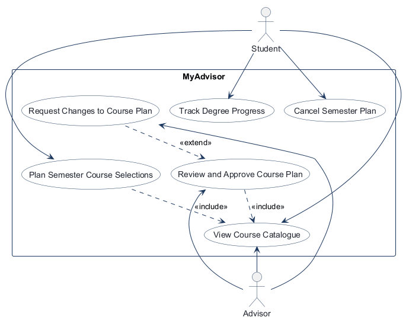
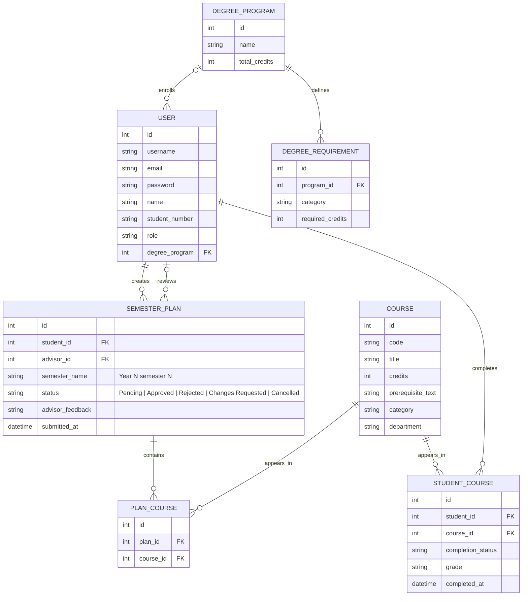
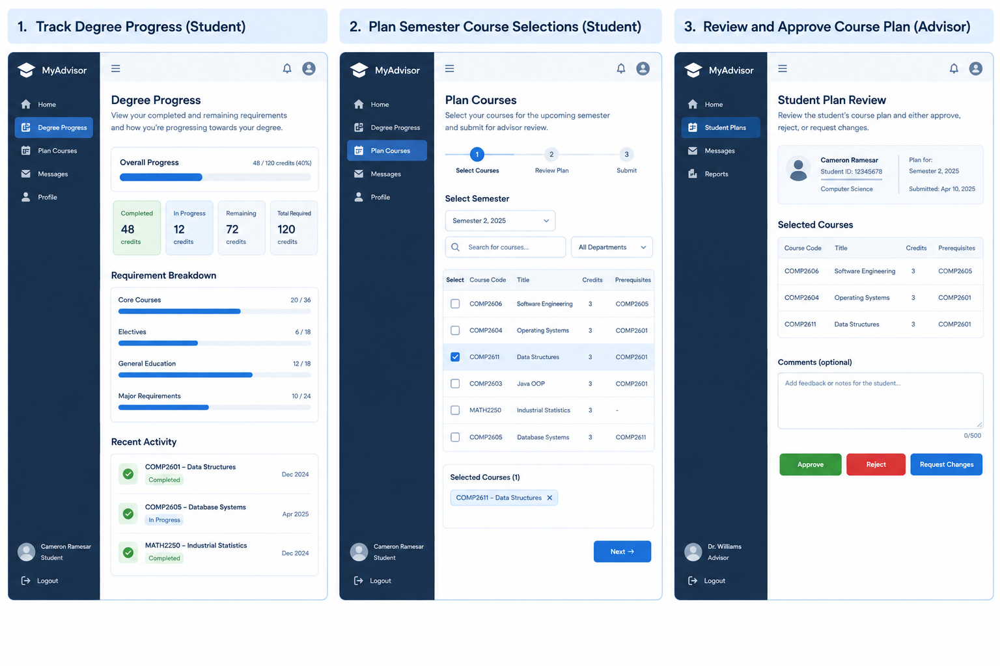

<!-- student-build:skill-integrity
status: pass
root: e84cd692d0b85eefe546385661958c27d07e8be6c5176a82012f68ccff5c8beb
expected_root: e84cd692d0b85eefe546385661958c27d07e8be6c5176a82012f68ccff5c8beb
mismatches: none
-->

# COMP 3613 Assignment 1

Draft this file with the Guide. **Update it after every phase milestone** before you pause. The use-case diagram is a UML PNG at `docs/diagrams/use-case.png`, linked from this file as `diagrams/use-case.png` (path relative to `docs/report.md`). The model diagram is Mermaid. **Embed wireframe images** as `wireframes/<file>` (files live in `docs/wireframes/`).

Do not put your student ID in this file if you will commit it. The PDF cover adds your name and ID at export time.

## Assigned project

MyAdvisor

## Three workflows

### 1. Track Degree Progress (Student)

Students can view their completed and remaining requirements, compare them to the degree plan, and understand where they stand academically.

### 2. Plan Semester Course Selections (Student)

Students select courses for the upcoming semester, check prerequisite eligibility, submit a plan for advisor review, and can cancel an existing plan.

### 3. Review and Approve Course Plan (Advisor)

Advisors review student plans, approve or reject them, or request changes for resubmission.

### Additional use cases

- **Cancel Semester Plan (Student):** Students may cancel a plan while it is Pending, Rejected, or Approved.
- **Request Changes to Course Plan (Advisor):** Advisors may request changes while reviewing a submitted plan. This use case `<<extend>>`s **Review and Approve Course Plan**.

## Use case diagram

## Model diagram

Revised in Phase 5 to support the degree-progress totals and requirement breakdown in the wireframe, plus profile, catalog, and plan-review details.

**Semester-plan business rules:** `semester_name` follows the exact pattern `Year X semester Y` (for example, `Year 1 semester 1`). The plan status may be Pending, Approved, Rejected, Changes Requested, or Cancelled. The student may cancel a plan in Pending, Rejected, or Approved status.

## Wireframes

### MyAdvisor dashboard mockup

<!-- student-build:wireframe-coverage
use_case: Track Degree Progress (Student)
image: docs/wireframes/Three-Panel Student Advisor Dashboard Mockup.png
covered: yes
-->

<!-- student-build:wireframe-coverage
use_case: Plan Semester Course Selections (Student)
image: docs/wireframes/Three-Panel Student Advisor Dashboard Mockup.png
covered: yes
-->

<!-- student-build:wireframe-coverage
use_case: Review and Approve Course Plan (Advisor)
image: docs/wireframes/Three-Panel Student Advisor Dashboard Mockup.png
covered: yes
-->

This single wireframe covers the three named workflows in a dashboard-style layout for the student advising flow.

### Three Panel Student Advisor Dashboard Mockup

## Theming

Brand preference: professional blue academic theme.

Applied in the landing page, login page, and registration page by updating the global CSS tokens to a blue/white academic palette, a serif display wordmark, and a cleaner student-advisor dashboard treatment. The final visual style is professional, trustworthy, and suited to a university advising system.

## Implementation notes

Phase 5 implements the three wireframed workflows in the existing FastStarter app:

- Student workspace navigation uses the AdminLTE 4.10.0 Bootstrap sidebar with Bootstrap Icons and OverlayScrollbars. Its hamburger button explicitly calls AdminLTE's push-menu API to open and close the responsive sidebar and keeps its expanded state accessible to assistive technology. It provides Home, Degree Progress, Plan Courses, Messages, and Profile tabs; advisor-only Advisor Review navigation is included.
- Home is a distinct student overview with latest semester-plan status and advisor feedback, recent activity, and quick links; Degree Progress separately displays degree totals and category breakdowns.
- Shared text and Bootstrap/AdminLTE secondary text utilities on app screens are forced to a high-contrast dark blue-gray; the authenticated header account name uses the dark foreground color for visibility. The Plan Courses tab uses darker secondary and ineligible-course text for legibility, and all text—including the explanatory paragraph—in pending, approved, and cancelled plan notices is white on dark backgrounds. Headings, labels, links, status colors, placeholders, and landing footer text use stronger foreground colors against their backgrounds.
- Track Degree Progress (Student): displays completed, in-progress, remaining, and total degree credits; progress by degree requirement category; student/program profile details; and recent course activity.
- Plan Semester Course Selections (Student): provides nine semester choices across three years in the "Year X semester Y" format; semester 3 in each year is summer. The backend uses the same allowed semester names for dashboard selection and plan submission. The tab also supports course search and department filtering, prerequisite eligibility feedback, a review step with credit totals, and plan submission. The demo catalog contains additional computer science, mathematics, statistics, writing, and physics courses; demo seeding does not create any pre-submitted plans. Students can add and remove courses from selections, remove individual courses from pending submissions, cancel pending, rejected, or approved plans while retaining their history, and edit/resubmit rejected or changes-requested plans. After cancellation, a fresh selection creates a brand new plan for the same semester. Registration captures the student's name and student ID and associates new students with the default degree program.
- Review and Approve Course Plan (Advisor): shows student identity/program, submission date, selected courses, credit totals, and prerequisites. Advisors can approve, reject, or request changes with up to 500 characters of feedback.
- Advisor workspace: admins see only Home, Messages, Profile, and Advisor Review navigation. Home summarizes student and plan-review statistics, the pending queue, and recent decisions; Messages lists the advisor's own decisions and feedback; Profile shows advisor account details and review totals.
- Workflow usability polish: empty states offer relevant next steps; course searches explain when filters return no results; plan validation names the exact missing prerequisites or other eligibility issue; primary actions use solid buttons while secondary and cancellation actions use outlined buttons.
- Plan status visibility: the Cancel Plan action uses a high-contrast solid red button, and rejected/changes-requested notices use a dark amber background with white text so advisor feedback and the resubmission instruction remain readable.

Verification: automated advising service and rendered-screen tests cover progress calculations, prerequisite-specific validation, plan review, request-changes resubmission, submitted-course removal, cancellation of pending, rejected, and approved plans, creation of a fresh plan for the same semester, student and advisor navigation/dashboard views, empty-state actions, the expanded course catalog, and idempotent demo seeding. Run `python manage.py run` to verify the rendered screens and interactive planning controls locally.

Model update: degree programs and per-category requirements support progress summaries; student profiles, catalog metadata, completed-course timestamps, semester plans, and selected courses support the workflows. Student-course and plan-course pairs are unique, and plan submission time is recorded. Existing databases are upgraded on startup with the added columns while retaining their rows.

## Deployed app

Phase 6 status: deployment is prepared but not completed from this workspace because the required Render MCP / Render deployment tooling is not available in the current environment. The app itself has been verified locally and is ready to deploy using the steps in [README.md](../README.md) and [render.yaml](../render.yaml).

Public Render URL (not localhost): not yet available in this session.

## Logins

Every account a marker needs, including extra users you added. Starter accounts:

- bob / bobpass — regular user
- admin / adminpass — admin

## YouTube URL

## Session transcripts

Filled when the Guide builds the report: the agent writes chat markdown into `docs/transcripts/`; `python manage.py report` packages them.

No transcript markdown in `docs/transcripts/` yet.

The Guide agent must pull every Guide chat for this project (Copilot Agent, Cursor, or OpenCode — do not assume Cursor) and write each to `docs/transcripts/<slug>.md`, then re-run `python manage.py report`.

## Competency (student-judge)

Filled by Guide from the student-judge run when this report was built.

**Judged at:** 2026-10-05T12:37:17-04:00
**Evidence pass:** re-read current docs/report.md, docs/diagrams/, docs/wireframes/, and local project validation output; prior judge markdown was ignored as stale.

## Phase-by-phase rubric

| Phase | Status | Notes |
|---|---|---|
| 1 — Project + workflows | Met | The report clearly names the assigned project as MyAdvisor and defines three core workflows: Track Degree Progress, Plan Semester Course Selections, and Review and Approve Course Plan. |
| 2 — Use-case diagram | Met | Use-case diagram is present and linked in the report; the report calls out shared and extended flows in the narrative. |
| 3 — Model diagram | Met | The ERD is named and represented as a Mermaid `erDiagram` with program, requirement, course, student course, semester plan, and plan course entities. |
| 4 — Wireframes | Met | Wireframe coverage is embedded in the report and the single dashboard mockup is mapped to the relevant workflows. |
| 5 — Theme + build + polish | Mostly met | The app has theming, workflow implementation, usability polish, and stronger status/feedback treatment; the project reports a validated local build. |
| 6 — Deploy | Not met | No live Render URL or deployed app evidence is recorded in the report yet. |

## Strengths

- The project matches the assignment brief with a clear MyAdvisor scope and three named workflows.
- The report includes the required use-case PNG and accepts a Mermaid model diagram for the ERD.
- The app appears to implement the advisor/student workflow in a polished dashboard pattern with role-aware views, plan status handling, and validation feedback.
- Project validation is clean: the CLI skill integrity check passes and the automated tests pass.

## Gaps

- Phase 6 is incomplete because the report still lacks a live Render URL and deployment evidence.
- The model diagram issue is not a scoring problem in itself, but the source Mermaid content was not rendered in the export until the Node tooling was installed and the report was regenerated.

## Awarded total / scoreable max

- Awarded: 24 / 30
- Overall: 3.2 / 4

## Summary

This is a strong assignment submission overall: the project is well-scoped, the workflow design is credible, the ERD and use-case artefacts are in place, and the local implementation is clearly validated. The main missing item is the live deployment evidence for Phase 6, which prevents a higher final mark.

## Skill integrity

Course skills are hashed at export and compared to `.agents/skills.lock.json`. Do not edit `.agents/skills/`, `.cursor/skills/`, or `AGENTS.md`.

- Status: **pass**
- Root: `e84cd692d0b85eefe546385661958c27d07e8be6c5176a82012f68ccff5c8beb`
- none
